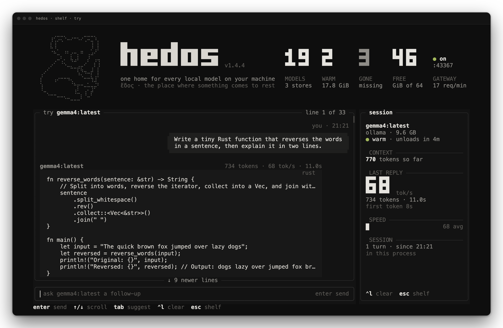
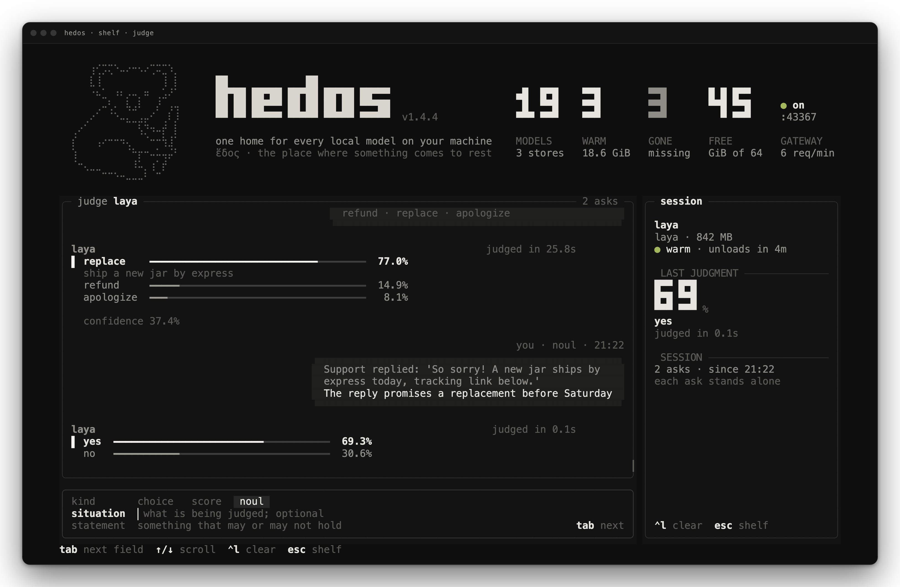

<picture>
  <source media="(prefers-color-scheme: dark)" srcset="assets/banner-dark.svg">
  
</picture>

<br/>

<p>
  <a href="https://github.com/theiskaa/hedos/actions/workflows/ci.yml"></a>
  <a href="https://hedos.ai/docs"></a>
  <a href="https://crates.io/crates/hedos"></a>
  <a href="https://github.com/theiskaa/hedos/releases"></a>
  <a href="Cargo.toml"></a>
  <a href="LICENSE"></a>
  <a href="https://crates.io/crates/hedos"></a>
</p>

hedos is a headless engine for the local models already on your machine. It finds them wherever they live, installs new ones, and serves each through the runtime that actually fits. It is one binary and a local HTTP gateway: no app, no browser wrapper, and everything runs on your hardware, offline.

It scans where models really sit (the Ollama store, the Hugging Face cache, LM Studio's library, loose GGUF and safetensors files) and puts them on one shelf without moving a byte.

Each model is resolved to the runtime that serves it: llama-server, Ollama, an OpenAI-compatible endpoint, or a managed Python sidecar. hedos knows its real context length, chat template, and tool-calling dialect, so a conversation behaves the same across engines. Where a model cannot do something, the shelf says so up front.

## Install
```sh
curl -fsSL https://hedos.ai/install | bash
```

The script installs `hedos` into `~/.local/bin` (set `HEDOS_BIN_DIR` to change it) after checking the download's SHA-256.

### Cargo
```sh
cargo install hedos
```

A `cargo install` build carries no llama.cpp (the other installs do); `hedos engines install llama.cpp` adds it, or hedos runs a `llama-server` on your `PATH`.

### Homebrew
```sh
brew install theiskaa/tap/hedos
```

### Prebuilt binaries
Prebuilt versions are available in our [GitHub releases](https://github.com/theiskaa/hedos/releases/latest):

|  File  | Platform | Checksum |
|--------|----------|----------|
| [hedos-aarch64-apple-darwin.tar.xz](https://github.com/theiskaa/hedos/releases/latest/download/hedos-aarch64-apple-darwin.tar.xz) | Apple Silicon macOS | [checksum](https://github.com/theiskaa/hedos/releases/latest/download/hedos-aarch64-apple-darwin.tar.xz.sha256) |
| [hedos-x86_64-apple-darwin.tar.xz](https://github.com/theiskaa/hedos/releases/latest/download/hedos-x86_64-apple-darwin.tar.xz) | Intel macOS | [checksum](https://github.com/theiskaa/hedos/releases/latest/download/hedos-x86_64-apple-darwin.tar.xz.sha256) |
| [hedos-aarch64-unknown-linux-gnu.tar.xz](https://github.com/theiskaa/hedos/releases/latest/download/hedos-aarch64-unknown-linux-gnu.tar.xz) | ARM64 Linux | [checksum](https://github.com/theiskaa/hedos/releases/latest/download/hedos-aarch64-unknown-linux-gnu.tar.xz.sha256) |
| [hedos-x86_64-unknown-linux-gnu.tar.xz](https://github.com/theiskaa/hedos/releases/latest/download/hedos-x86_64-unknown-linux-gnu.tar.xz) | x64 Linux | [checksum](https://github.com/theiskaa/hedos/releases/latest/download/hedos-x86_64-unknown-linux-gnu.tar.xz.sha256) |

### Upgrade
```sh
hedos upgrade
```

It upgrades the way hedos was installed: through Homebrew or cargo when one of them installed it, by replacing the binary with the newest release's (checked against its SHA-256) when the install script or a release archive did, and not at all for a source build, which you pull and rebuild. `hedos upgrade --check` only says whether a newer release is out. Every command also ends with a one-line notice when one is; see [`hedos upgrade`](docs/cli.md#hedos-upgrade) to turn it off.

### Engines
hedos runs models on engines, and installs one only when you ask. `hedos engines` shows which are here.

- **llama.cpp comes with hedos.** It runs GGUF models, the chat and coding models `hedos recommend` offers among them. The install script, Homebrew, and the release archives carry the llama.cpp build hedos pins (0.7.0, Metal on Apple Silicon, the CPU build on Intel Macs and Linux), which unpacks the first time a model runs. hedos runs its own build ahead of any `llama-server` on your `PATH`, so an older one there never gets in the way; `[engines] llama_server` picks another. A faster build for your machine (CUDA for an NVIDIA card, Vulkan for AMD) is one `hedos engines install llama.cpp` away: it says what it will fetch, from where, how big, and where it goes, then asks. A `cargo install` or source build carries none, and uses that command, or a `llama-server` on the `PATH`; `hedos pull` offers it once a GGUF model lands and none is here. On Linux, hedos and the llama.cpp it carries (built by hedos from llama.cpp's pinned source) run on glibc 2.35 or newer (Ubuntu 22.04, Debian 12, Fedora 36); the builds `hedos engines install` fetches are llama.cpp's own and need glibc 2.38 (Ubuntu 24.04, Debian 13, Fedora 39), which it checks before fetching anything.
- [`uv`](https://astral.sh/uv) for the Python sidecar runtimes (mlx-lm, mlx-vlm, speech, embeddings, diffusers, mflux, whisper). It builds their environments the first time they run; the runtime code ships inside the binary.
- **Ollama** is optional. The models already in its store are on the shelf: Ollama serves them while it is installed, and llama.cpp serves the ones it can load when it is not. hedos starts the daemon if it is installed but not running.

## Quick start
```sh
hedos scan                             # discover every model on this machine
hedos ls                               # list them with runtime, store, fit, and capabilities
hedos recommend                        # what this machine can run, and what to pull for it
hedos pull ggml-org/gemma-4-E4B-it-GGUF   # a GGUF model from Hugging Face
hedos run gemma-4-E4B-it-GGUF "explain this"   # stream a completion to your terminal
hedos shelf                            # the shelf as a terminal screen
hedos serve                            # start the local gateway
hedos launch opencode -m gemma-4-E4B-it-GGUF   # run a coding harness on a local model
```

With the right kind of model on your shelf:

```sh
hedos run llava "describe" --image photo.png        # ask a vision model about an image
hedos transcribe whisper-large-v3 voice.wav         # transcribe a WAV file to text
hedos rm gemma-4-E4B-it-GGUF --yes                  # delete a model
hedos stats                                         # per-model usage from the gateway audit log
hedos bench                                         # what every model does on this machine
```

A model name does not have to be exact on the command line: a unique part of it is enough. Every command takes `--json` for machine-readable output instead of formatted text. `hedos ls` shows a fit verdict next to each model's capabilities: whether it will actually run in this machine's memory.

New here? [docs/getting-started.md](docs/getting-started.md) walks through the first five minutes.

## The shelf in the terminal


`hedos shelf` is the same shelf as a screen you keep open. It shows every model with its runtime, store, and size; the selected one's fit, residency, and capabilities; what is loaded and by whom, with a memory bar per model; disk per store; and what the gateway served in the last day.

The footer shows only the keys that apply to the model under the cursor, and the keys do what the subcommands do: `p` pulls, `w` and `u` warm and unload, `x` removes with a preview, `S` serves.

Press `t` and the shelf gives way to a conversation with the selected model. The reply streams in and keeps its markdown. It scrolls with the wheel or the arrows and holds still while more text arrives, and the model stays warm for whatever comes next.

`T` opens `hedos chat` in the plain terminal instead, and `l` launches a coding harness on the model. The UI steps aside for anything that needs the terminal and is back the moment it ends, with a row in the task strip saying how it went.



On a decision model (a judge such as laya), `t` opens a composer for typed questions instead: a situation, a question, and the options or levels it may answer with. The answer comes back as a distribution, a bar and a share for each outcome, with the model's pick marked.



Pulls download in the task strip while you keep working. `c` asks whether to pause or cancel one, and `P` opens a screen of every pull with the selected one's rate, estimate, and history.

Every text field edits like a shell line (Ctrl-A/E, Ctrl-U, Ctrl-W, the arrows). It works over ssh and inside tmux. The [shelf guide](docs/shelf.md) covers every key and pane.

## Coding harnesses
`hedos launch` runs a coding harness against a local model with nothing to configure. The gateway starts inside the same process on a free port, the harness is wired to it, and both stop together:

```sh
hedos launch                      # pick a harness, then a model
hedos launch claude -m qwen3      # or name both
```

Claude Code, OpenCode, Aider, Goose, and Crush are supported. The interactive picker lists only the ones installed on your `PATH`, so it never offers a harness that would then fail to launch. Naming one you do not have points you at where to get it.

Your own harness config is never touched, so running the harness directly afterwards behaves exactly as it did before.

## The gateway
`hedos serve` binds an OpenAI-, Ollama-, and Anthropic-compatible HTTP server to loopback (`127.0.0.1:43367` by default). Any editor, script, or agent on the machine can point at it and reach the models you own, tools and all:

```sh
curl http://127.0.0.1:43367/v1/chat/completions \
  -d '{"model":"gemma-4-E4B-it-GGUF","messages":[{"role":"user","content":"hi"}]}'
```

The gateway takes the model's name as `hedos ls` shows it (or its id), not a fragment. Decision models also answer typed questions on `/v1/systemone`. See [docs/gateway.md](docs/gateway.md) for every endpoint.

The gateway is bound to loopback and treats every local caller as trusted. It does not require a token. Keep it on `127.0.0.1`; see [SECURITY.md](SECURITY.md) for what that means.

## Managing models
The shelf is not read-only. The install service resolves a reference (a `huggingface.co` or `ollama.com` link, an `org/repo`, or a `name:tag`) and plans the install before a byte moves: the file set, the sizes, the destination, and the pinned revision.

Installs write into each platform's native habitat:

- Ollama tags (`name:tag`) pull through Ollama's daemon, so they need Ollama installed.
- Hugging Face models download into the standard hub cache layout (blobs, snapshots, refs), with `Range` resume and incremental SHA-256 checked against the hashes the LFS listing names.

hedos owns no weights directory, so every other tool still sees the model. Installs never touch the registry either: the scanners discover the result. Gated repositories authenticate with `HF_TOKEN` from the environment, or the token `huggingface-cli login` writes.

A pull outlives the terminal that started it. `hedos pull <ref>` hands the download to a worker process of its own and follows it. Ctrl-C detaches and leaves it running, and `-d` never attaches at all.

`hedos pull ls` lists every pull, and `attach`, `pause`, `resume`, `cancel`, and `logs` act on one by id. A transfer that breaks retries with a growing pause before it is left for you to resume. A worker that died while the machine slept is picked back up the next time the shelf opens, and pulling the model again carries any stopped pull on.

Removal is symmetric. `hedos rm <model>` shows a deletion preview (the files, the estimated bytes) and asks before it deletes anything; `-y` skips the question, and is required when there is no terminal to ask in. File-backed models are deleted from disk. Ollama models delete through the daemon, or, with Ollama not installed, by the files that model alone uses (a blob another tag shares stays). See [docs/models.md](docs/models.md).

## Runtimes
Each runtime is present whether or not its backend is installed. A capability only actually serves when its backend is available on the machine:

- **Local GGUF** runs on llama.cpp: the `llama-server` that `[engines] llama_server` names, else a build `hedos engines install llama.cpp` installed, else the one hedos carries, else one on the `PATH`.
- **Ollama** serves the models in its store while it is installed, and hedos starts the daemon if it is not running. Without it, llama.cpp serves the ones it can load; the few kept in Ollama's own format say they need Ollama.
- **OpenAI-compatible endpoints** serve endpoint records in the registry. The base URL comes from the record; the API key, when the server needs one, comes from `HEDOS_OPENAI_API_KEY`.
- **The Python sidecars** (mlx-lm, mlx-vlm, speech, embeddings, diffusers, mflux) and **whisper** need [`uv`](https://astral.sh/uv), which builds their environment on first use. Their runtime code ships inside the binary.
- **Manifest runtimes**, such as the decision runtimes for laya and zerank, run code on your machine, so they wait for your approval: `hedos runtimes approve <id>`. See [docs/configuration.md](docs/configuration.md#manifest-runtimes-and-consent).
- **Image daemons** (ComfyUI, AUTOMATIC1111) need the daemon running.
- **Apple Intelligence** needs a Mac where Apple's on-device model is enabled and ready, plus the bridge library beside the `hedos` binary. See the note below.

> **Apple Intelligence and `cargo install`.** The bridge to Apple's model is a companion dynamic library, `libhedos_apple_shim.dylib`, compiled next to the binary during a source build on a Mac whose SDK carries the `FoundationModels` framework.
>
> Installers that copy only the binary (the install script, `cargo install`, Homebrew, and the prebuilt archives) leave it behind. Apple Intelligence then still lists on the shelf but answers with *"Apple's model needs the Apple Intelligence bridge, which is not built into this binary."* No other runtime is affected.
>
> To enable it, build the library from source and drop it next to your `hedos` binary:
>
> ```sh
> cargo build --release
> cp "$(ls -t target/release/build/hedos-runtime-*/out/libhedos_apple_shim.dylib | head -1)" \
>    "$(dirname "$(command -v hedos)")/"
> ```
>
> hedos looks for the library next to the binary, so that is all it takes. Alternatively, point the `HEDOS_APPLE_SHIM` environment variable at the library's full path.

The MLX-Swift runtime from the original macOS build is framework-bound and intentionally out of this headless port; its models are served by the MLX sidecars instead.

## Configuration
Settings live in one human-editable file at `~/.config/hedos.toml` (or `$XDG_CONFIG_HOME/hedos.toml`). It is optional: every key has a default.

State lives under `~/.local/share/hedos` (or `$XDG_DATA_HOME/hedos`): the registry, generated artifacts, job history, pull records, the gateway's audit log, and the sidecar work directories. None of it holds model weights.

See [docs/configuration.md](docs/configuration.md) for every setting and environment variable, and [docs/architecture.md](docs/architecture.md) for how the pieces fit together.

## Contributing
Deeper guides live in [docs/](docs/README.md). See [CONTRIBUTING.md](CONTRIBUTING.md) for how to build, test, and open a pull request; logic lives in the kernel and the CLI stays a thin shell over it. Participation is governed by our [Code of Conduct](CODE_OF_CONDUCT.md), and security issues have a private channel in [SECURITY.md](SECURITY.md).

hedos is MIT-licensed. See [LICENSE](LICENSE). Release builds also carry [llama.cpp](https://github.com/ggml-org/llama.cpp), MIT-licensed, copyright The ggml authors; its `LICENSE` travels inside the binary and is unpacked beside the build in `engines/llama.cpp/` under the data directory.
